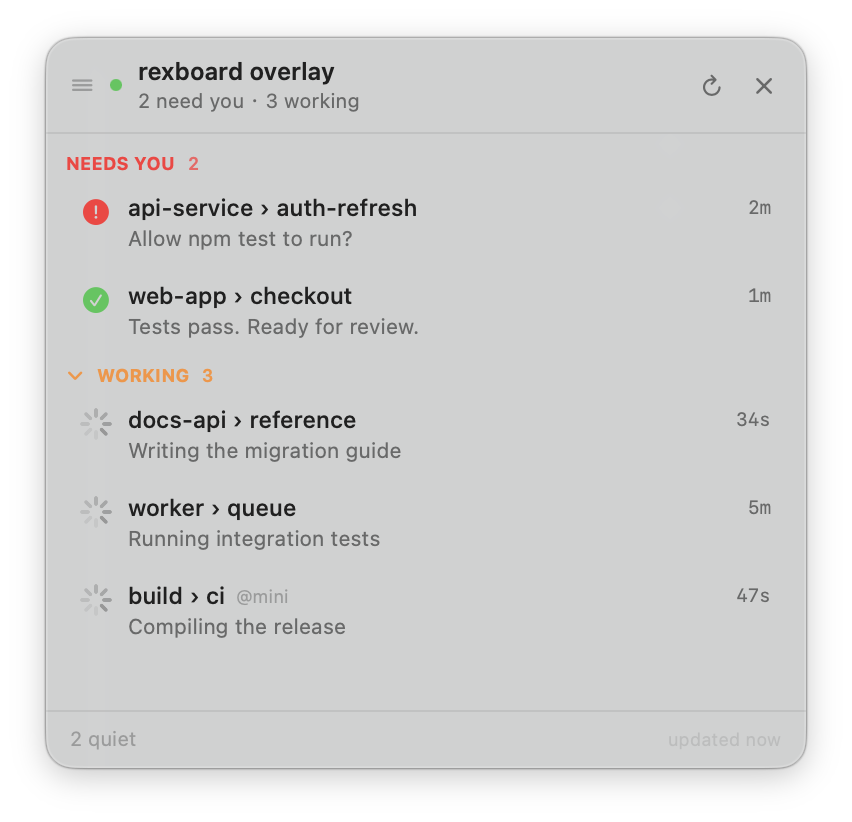

# Rexboard Overlay

A system-level always-on-top panel for [rexboard](https://github.com/vanducng/rexboard). It shows the agent panes that need you across every Rex host, stays above other apps and Spaces, and jumps to the pane in Rex when you click a row.

This is a separate macOS app, not a Rex plugin: Rex has no plugin API for native windows. It keeps one `rexboard watch --json` stream open and runs `rexboard jump <key>` on click.



## Build and run

```sh
./build.sh
open -a "$HOME/Applications/Rexboard Overlay.app"
```

Requires Xcode or the Command Line Tools (`swiftc`), and a [rexboard](https://github.com/vanducng/rexboard) binary in a standard install location.

## Use

- The panel floats above normal windows. Drag the grip at the top left to move it; its position and size are remembered.
- Click a `NEEDS YOU` or `WORKING` row to run `rexboard jump <key>` and bring Rex forward.
- The `WORKING` header collapses that section.
- The `x` hides the panel. The menu bar icon shows the number of panes that need you; its menu can show the overlay again, refresh, open Rex, start at login, or quit.
- A row on a remote host gets an `@host` suffix.
- `rexboard --version` and `rexboard hooks status` are independent; this app does not install agent hooks.

## URL scheme

The app registers `rexboard-overlay://`:

```sh
open 'rexboard-overlay://toggle'
open 'rexboard-overlay://show'
open 'rexboard-overlay://hide'
open 'rexboard-overlay://refresh'
```

This lets a Rex action toggle the overlay. For example, add to `~/.config/rex/init.lua`:

```lua
rex.action{
  name = "rexboard_overlay",
  title = "Rexboard: system overlay",
  description = "Show or hide the always-on-top rexboard panel.",
  category = "Rexboard",
  keywords = "rexboard overlay agents attention",
  run = function()
    rex.exec({ "/usr/bin/open", "rexboard-overlay://toggle" })
  end,
}
rex.bind("ctrl+space>o", "rexboard_overlay")
```

## Tuning

- Data source: one long-lived `rexboard watch --json` process. If it exits, the app restarts it with backoff (1s, doubling to 10s). The UI clock ticks once a second to refresh ages.
- Rows: needs-you rows are always shown; working rows are capped at 3 with a `+N more` line.
- Panel width: `AppDelegate.panelWidth` (380).
- Background: `VisualEffectView(material: .hudWindow)`.
- Screenshot/demo data: launch the binary with `REXBOARD_OVERLAY_DEMO=1` to show generic rows without calling rexboard.

## Limitation

It is a foreground-level helper app, not a Rex plugin. It reads rexboard's CLI output, so it inherits rexboard's behavior and needs the Rex app to answer a jump. The Rex app must be running for `rexboard jump` to land on a pane.

This is an unofficial companion app. It is not affiliated with Rex or rexboard; [rexboard](https://github.com/vanducng/rexboard) is MIT-licensed and remains its own project.

## License

MIT. See [LICENSE](LICENSE).
